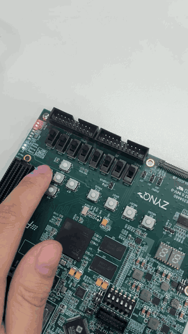

# HW2：自製 AXI4-Lite IP（btnled_ip）＋按鈕中斷（bare-metal）

> 學號：f115112130　姓名：蔡孟廷

開發板：ego-xz7（Zynq-7000 xc7z020clg484-1）
工具：Vivado 2018.3、Xilinx SDK 2018.3

## 作業目標
把 HW1 的按鈕 / LED 從 Xilinx AXI GPIO 換成**自己寫的 RTL**，用 Vivado 的 *Create and Package New IP* 包成 AXI4-Lite IP，並由 IP 自己產生按鈕中斷送進 Zynq 的 GIC。這顆 IP 也是 HW4（掛到 Linux）的硬體基礎。

## 為什麼要包成 IP
一般的 `.v` 模組只有 `clk`、`btn`、`led` 這些腳，CPU 無法存取。加上 **AXI4-Lite slave 介面**包成 IP 後，Vivado 會分配實體位址（0x43C00000），CPU（以及之後的 Linux driver）才能透過 SoC bus 讀寫它。

## 硬體架構

```
                ┌──────────── btnled_ip_0 (0x43C00000) ────────────┐
 btn[4:0] ────► │ 2 級 FF 同步 → 20ms 去彈跳 → 上升緣偵測            │
                │       btn_press ─► irq_status (鎖存，寫 1 清除)    │
                │                     & IRQ_ENABLE[0] ─────────────► irq ─► xlconcat In0 ─► IRQ_F2P[0] ─► GIC 61
 led[7:0] ◄──── │ slv_reg0[7:0]                                     │
                │ AXI4-Lite slave（4 個 32-bit 暫存器）◄── M_AXI_GP0 │
                └───────────────────────────────────────────────────┘
 axi_timer_0 (0x42800000) ── interrupt ─► xlconcat In1 ─► IRQ_F2P[1] ─► GIC 62
```

### 暫存器表

| Offset | 名稱 | 讀寫 | 說明 |
|---|---|---|---|
| 0x00 | LED | RW | `slv_reg0[7:0]` 直接接到 8 顆 LED |
| 0x04 | BTN | RO | 去彈跳後的 5 顆按鈕值 `btn_db` |
| 0x08 | IRQ_STATUS | R / 寫 1 清除 | bit0 = 有按鈕按下事件尚未處理 |
| 0x0C | IRQ_ENABLE | RW | bit0 = 1 才把 irq 送出 |

功能上最少需要 3 個暫存器（LED、BTN、清中斷）；IRQ_ENABLE 讓軟體先設好 GIC 再開中斷。Vivado 的 AXI4-Lite 範本最少也是 4 個暫存器。

### RTL 重點（[`btnled_ip_v1_0_S00_AXI.v`](ip_repo/btnled_ip_1.0/hdl/btnled_ip_v1_0_S00_AXI.v)）

| 階段 | 訊號 | 目的 |
|---|---|---|
| ① 同步 | `btn_s1`、`btn_s2` | 按鈕是非同步訊號，兩級 FF 避免亞穩態 |
| ② 去彈跳 | `db_cnt`、`btn_db` | 連續穩定 1,000,000 clock（50MHz = 20ms）才更新，避免一次按壓觸發多次 |
| ③ 緣偵測 | `btn_press = \|(btn_db & ~btn_db_d)` | 只在按下（0→1）產生 1 個 clock 脈波，放開不觸發 |
| ④ 鎖存 | `irq_status` | 脈波只有 20ns，CPU 來不及看，用 FF 鎖住直到軟體清除 |
| ⑤ 遮罩 | `irq = irq_status & slv_reg3[0]` | 軟體決定何時開中斷 |

```verilog
assign btn_press = |(btn_db & ~btn_db_d);
assign irq_clear = slv_reg_wren &&
                   (axi_awaddr[ADDR_LSB+OPT_MEM_ADDR_BITS:ADDR_LSB] == 2'h2) &&
                   S_AXI_WDATA[0];
always @(posedge S_AXI_ACLK)
  if (!S_AXI_ARESETN)  irq_status <= 1'b0;
  else if (btn_press)  irq_status <= 1'b1;
  else if (irq_clear)  irq_status <= 1'b0;
assign led = slv_reg0[7:0];
assign irq = irq_status & slv_reg3[0];
```

- **寫入路徑（CPU → IP）**：`Xil_Out32(0x43C00000, v)` → AXI 寫通道 → `slv_reg_wren` 拉高 → 依 `axi_awaddr[3:2]` 存進 `slv_reg0~3`。範本中 `default: slv_regX <= slv_regX` 只是「保持原值」，不會傳資料給 CPU。
- **讀取路徑（IP → CPU）**：`reg_data_out` 依 `axi_araddr[3:2]` 選擇 `slv_reg0`、`btn_db`、`irq_status`、`slv_reg3`，經 `S_AXI_RDATA` 回到 CPU。

### 中斷為什麼是 61
Zynq 規定 PL 進來的 IRQ_F2P[7:0] 對應 GIC SPI 61～68、[15:8] 對應 84～91（UG585 第 7 章）。btnled_ip 接 xlconcat In0 → IRQ_F2P[0] → **61**；Timer 接 In1 → **62**。GIC（Generic Interrupt Controller，ARM PL390）收集所有中斷、判斷開關與優先權後通知 CPU，軟體用 `XScuGic_Connect` 把 ISR 註冊到第 61 格。

中斷是 **level-triggered**：ISR 一定要寫 0x08 清除 `irq_status`，否則 CPU 一離開 ISR 又被拉回去（軟硬體握手）。

## 檔案
| 檔案 | 說明 |
|---|---|
| `ip_repo/btnled_ip_1.0/hdl/btnled_ip_v1_0.v` | IP 上層，加了 `btn[4:0]`、`led[7:0]`、`irq` port |
| `ip_repo/btnled_ip_1.0/hdl/btnled_ip_v1_0_S00_AXI.v` | AXI4-Lite 介面與使用者邏輯 |
| `constraints/btnled.xdc` | LED / 按鈕腳位（從 HW1 的實作結果取出） |
| `src/main.c` | bare-metal 測試程式（btnled_ip + AXI Timer） |

## 製作步驟
1. **Tools → Create and Package New IP → Create a new AXI4 peripheral**，名稱 `btnled_ip`，AXI4-Lite Slave、32 bit、4 個暫存器；**不勾 Enable Interrupt Support**（自己拉 `irq` 腳，driver 較簡單）
2. 最後一頁選 **Edit IP**，修改兩個 `.v`，Run Synthesis 確認語法
3. Package IP → Ports and Interfaces：`irq` 會被自動辨識為 interrupt 介面，Edit Interface → Parameters 設 `SENSITIVITY = LEVEL_HIGH` → Re-Package IP
4. Block Design：刪除 `axi_gpio_0/1` 與 `leds_8bits`、`btns_5bits` 外部 port → Add IP `btnled_ip` → Run Connection Automation
5. `irq` 接 `xlconcat_0/In0`（原本接 GPIO 中斷的位置）；`btn`、`led` Make External 並改名為 `btn`、`led`
6. 加入 `btnled.xdc`，停用舊的 `pin.xdc` → Generate Output Products → Generate Bitstream → Export Hardware（Include bitstream）
7. SDK：新建 Application，BSP 綁定新的 hw_platform，`xparameters.h` 應出現：
   ```c
   #define XPAR_BTNLED_IP_0_S00_AXI_BASEADDR 0x43C00000
   #define XPAR_FABRIC_BTNLED_IP_0_IRQ_INTR 61U
   ```

## 軟體（[`src/main.c`](src/main.c)）
- 不再使用 `XGpio`，改用 `Xil_In32` / `Xil_Out32` 直接存取暫存器
- `XScuGic_SetPriorityTriggerType(61, 0xA0, 0x1)` 設為 level high
- ISR：讀 0x04 取得按鈕值 → **寫 0x08 清中斷** → `xil_printf` 印次數 → LED 歸零
- 先設好 GIC，最後才寫 0x0C 開 IP 的中斷輸出

## 執行結果

### 實作影片
按下板子上的按鈕觸發中斷，左上角的 LED 跟著改變。



完整影片：[docs/demo.mp4](docs/demo.mp4)

### 終端機輸出
預期終端機輸出：
```
=== btnled_ip test (base 0x43c00000, irq 61) ===
Init successful
[TIMER] 5 sec reminder #1  (total 5 sec)
[BTN] Interrupt : 1  (btn = 0x1)
```
快速連按 / 長按時每按一次只會 +1（硬體去彈跳 + 只抓按下緣）。
<!-- TODO：補上實機終端機截圖、Block Design 截圖、Address Editor 截圖 -->

## 與 HW1（AXI GPIO）比較
| | HW1：AXI GPIO | HW2：btnled_ip |
|---|---|---|
| 觸發時機 | 按下、放開都觸發 | 只有按下 |
| 去彈跳 | 無 | 硬體 20ms |
| ISR 工作 | 判斷按下 / 放開、`XGpio_InterruptClear` | 讀值、寫 0x08 清除 |
| 暫存器 | Xilinx 定義 | 自己定義 |

## 遇到的問題與解決方法

| # | 問題 | 原因 | 解決方法 |
|---|---|---|---|
| 1 | 不確定作業要不要包成 IP | — | Linux driver 需要實體位址，只有掛在 AXI bus 上的 IP 才有，所以包成 AXI4-Lite IP |
| 2 | 建 IP 最後一頁直接按 Finish 只會加入空殼 | 預設選項是 Add IP to the repository | 改選 **Edit IP** 才能修改 RTL；之後可從 IP Catalog → 右鍵 → Edit in IP Packager 回來改 |
| 3 | Verilog 報 `not declared` | `btn_db`、`irq_status` 在讀取路徑使用時尚未宣告 | 把宣告移到 `integer byte_index;` 後面（讀取 case 之前） |
| 4 | 板子是 8 LED / 5 按鈕，RTL 寫成 4 bit | 一開始假設 4 顆 | `btn[4:0]`、`led[7:0]`、`{27'd0, btn_db}`、`slv_reg0[7:0]`，Re-Package 後 Upgrade IP |
| 5 | Validate 出現 `BD 41-759 ... /btnled_ip_0/btn` 未連接 | `btn` 還沒拉出外部 port | 右鍵 Make External，改名為 `btn` |
| 6 | `irq` 被誤拉成外部 port（`get_bd_ports` 有 `/irq`），CPU 收不到中斷 | 對 irq 也做了 Make External | `delete_bd_objs` 刪除外部 irq，`connect_bd_net btnled_ip_0/irq xlconcat_0/In0` |
| 7 | 不知道 irq 該接 In0 還是 In1 | — | 舊 `xparameters.h`：GPIO = 61（In0）、Timer = 62（In1），所以接空出來的 In0 |
| 8 | `set_property expects at least one object` | 舊的 `pin.xdc` 還用 `leds_8bits_tri_o` 等舊名稱；新的 `btnled.xdc` 存檔前是空的 | 停用 `pin.xdc`（Disable File），`btnled.xdc` 貼入腳位後 Ctrl+S |
| 9 | 腳位不知道 | 原本由 board file 自動指定 | 在舊設計 Open Implemented Design，用 Tcl 迴圈讀出每個 port 的 `PACKAGE_PIN`、`IOSTANDARD` 自動產生 XDC |
| 10 | `write_bitstream exception: bad allocation` | 記憶體不足（同時開 Vivado、SDK、瀏覽器） | 關閉 SDK 與已開啟的 Synthesized/Implemented Design，只對 `impl_1` 重跑 Generate Bitstream |
| 11 | SDK 的 `xparameters.h` 還是舊的 axi_gpio | 舊 BSP 綁在 `hw_platform_1`，SDK 更新的是 `hw_platform_2`；右鍵選單沒有 Change HW Platform | 新建 Application（`btnled_app`）綁 `hw_platform_2`，BSP 的 Peripheral Drivers 出現 `btnled_ip_0` |
| 12 | Run 出現 `Invalid hardware project` | Run Configuration 指到不存在的 hw_platform | Target Setup 改選正確的 hw_platform |

## 參考資料
- UG585 Zynq-7000 TRM（第 7 章 Interrupts、GIC）
- UG1118 Vivado Creating and Packaging Custom IP
- ARM IHI0048 Generic Interrupt Controller Architecture
